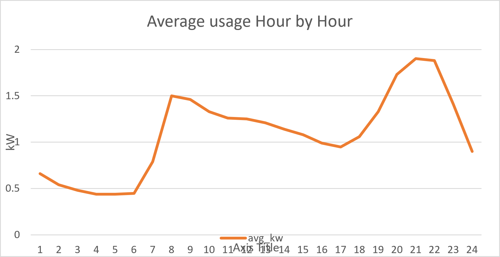
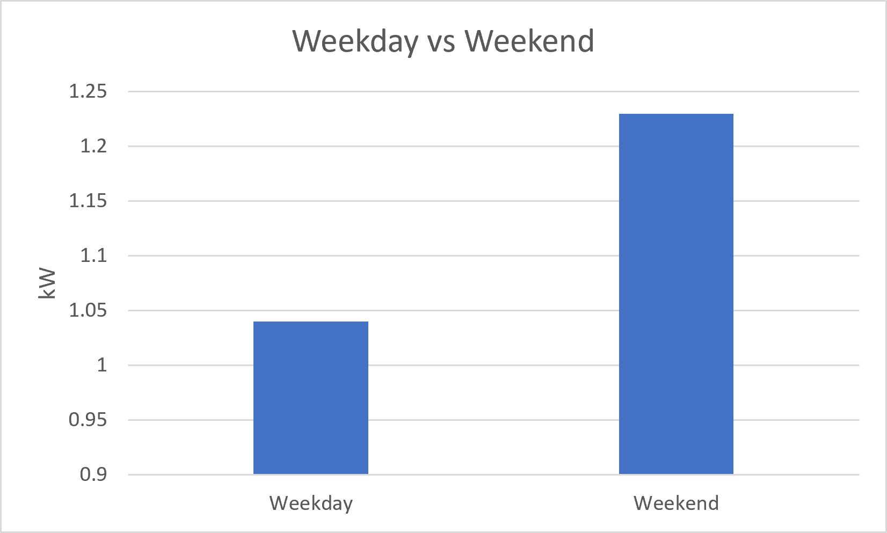
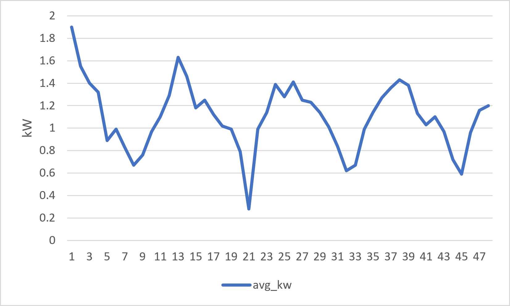

# Household Energy Consumption Analysis

Analysis of four years of household electricity usage (Dec 2006 to Nov 2010) using Python (pandas), PostgreSQL and Excel.

## Dataset
UCI Individual Household Electric Power Consumption (UCI Machine Learning Repository): minute-level readings, about 2 million rows. The raw file is not included in this repo because of its size. Global active power is in kilowatts; the three sub-meters are in watt-hours and cover the kitchen, the laundry room, and the water heater plus air conditioner.

## Data cleaning
- Raw data: 2,075,259 minute-level rows, 16 Dec 2006 to 26 Nov 2010.
- Duplicate rows: 0.
- Missing readings: 25,979 minutes (1.25% of rows). Every measurement column was missing at the same time, spread over 71 separate outage blocks. The longest was 7,226 minutes (about 5 days, Aug 2010), which points to the meter being offline, not random bad readings.
- Decision: dropped the missing minutes instead of filling them in, because there is no reading to correct.
- Aggregated the remaining readings to 34,168 hourly averages.

## Method
Cleaned the data in Python (pandas), aggregated minute readings to hourly averages, loaded them into PostgreSQL, and analysed them with SQL. Charts made in Excel.

## Findings
1. **Peak hours:** average usage peaks at 20:00 (8 pm) at 1.9 kW and is lowest at 04:00 at X kW.
2. **Weekday vs weekend:** weekends average 1.23 kW against 1.04 kW on weekdays, about 18% higher.
3. **Monthly trend:** average usage fell from 1.32 kW in March 2007 to 0.89 kW in April 2007, then rose to 1.63 kW by December 2007.

## Charts

## Limitations
- Because of the meter outages, some months have fewer recorded hours. Monthly figures are averages of the hours recorded, so months stay comparable, but a month with a long outage rests on less data.
- The first and last months are partial.
- The dataset has no weather or occupancy data, so these findings describe patterns, not causes.

## What I learned
- Missing data does not always look like scattered gaps. Here it came as 71 whole-row meter outages, so I dropped those minutes instead of filling them in, since filling would have invented readings.
- Aggregating 2 million minute-level rows into 34,168 hourly averages made the data far quicker to query and chart without losing the daily pattern.
- I learned to pull parts out of a timestamp with EXTRACT and DATE_TRUNC and then group by them, which is how I found the peak hour, the weekday vs weekend gap, and the monthly trend.
- Because outages left some months with fewer recorded hours, I compared averages instead of totals and checked the number of hours recorded for each month.
- Next, I would use the sub-meter columns to see which part of the house accounts for the evening peak.

## How to run
1. Download the dataset from the UCI repository and place `household_power_consumption.txt` in this folder.
2. Run `pip install pandas`.
3. Run `analysis.py`. It cleans the data and writes `hourly_power.csv`.
4. In PostgreSQL, create a database and the `hourly_power` table (the `CREATE TABLE` statement is at the top of `queries.sql`), then import `hourly_power.csv`.
5. Run the queries in `queries.sql`.
